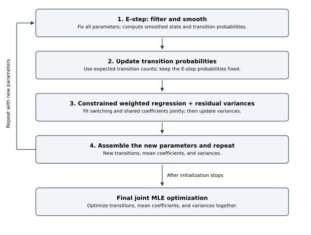

```{raw:typst}
#set page(margin: auto)
```

# Regime-Switching Inflation Models

The identification and likelihood-maximization procedure follows
[Bekaert, Engstrom and Ermolov (2015)](../Bekaert2015.md), Section 4.1.2 and
Appendix B. I apply their Gaussian regime-switching likelihood, unconditional
initial regime probabilities, variance-based labeling, multiple initial
parameter vectors, and final-solution perturbation checks to the inflation
mean processes below.

## Model Specification

I illustrate the algebra with a **two-regime ARX(2,2) model**. The
intercept, AR coefficients, and innovation standard deviation switch
across regimes; the SPF coefficients are shared.

**Specify the observation equation and identify the shared coefficients.**

$$
\begin{aligned}
\text{Regime 1:}\quad
\pi_{t+1}&=c_1+\rho_{1,1}\pi_t+\rho_{2,1}\pi_{t-1}
+\phi_1SPF_t+\phi_2SPF_{t-1}+\sigma_1z_{t+1},\\
\text{Regime 2:}\quad
\pi_{t+1}&=c_2+\rho_{1,2}\pi_t+\rho_{2,2}\pi_{t-1}
+\phi_1SPF_t+\phi_2SPF_{t-1}+\sigma_2z_{t+1}.
\end{aligned}
$$

Here $\pi_t$ is inflation, $SPF_t$ is its next-period forecast available
at $t$, and $SPF_{t-1}$ is the preceding forecast. The shocks $z_{t+1}$
are independent standard normals, independent of regime transitions,
and $\sigma_i>0$. In $\rho_{\ell,i}$, $\ell$ indexes the lag and $i$ the
regime. The same estimated $\phi_1,\phi_2$ enter both equations.

### Observed Regressors and Coefficients

**Collect the observed inputs in $X_t$ and write the conditional mean as $\mathbb{D}_iX_t$.**

For the example,

$$
X_t=\begin{pmatrix}1\\\pi_t\\\pi_{t-1}\\SPF_t\\SPF_{t-1}\end{pmatrix},\qquad
\mathbb{D}_i=(c_i,\rho_{1,i},\rho_{2,i},\phi_1,\phi_2).
$$

Let $\mathcal{F}_t$ denote the observed history and forecast information
available before $\pi_{t+1}$. Conditional on regime $i$,

$$
\boldsymbol{\pi_{t+1}=\mathbb{D}_iX_t+\sigma_iz_{t+1}},\qquad
\boldsymbol{\hat{\pi}_{t+1}(i)
=E[\pi_{t+1}\mid\mathcal{F}_t,Z_t=e_i]=\mathbb{D}_iX_t}.
$$

### Hidden Regime and Its Probabilities

**Represent the regime by an indicator vector; its conditional expectation is a probability vector.**

Set $Z_t=e_i$ when regime $i$ generates $\pi_{t+1}$. For two regimes,

$$
e_1=\begin{pmatrix}1\\0\end{pmatrix},\qquad
 e_2=\begin{pmatrix}0\\1\end{pmatrix}.
$$

For $K$ regimes, $e_i$ is a $K$-dimensional column vector with a one in position $i$ and zeros elsewhere. Thus,
for any conditioning information $\mathcal{I}$,

$$
\boldsymbol{E[Z_t\mid\mathcal{I}]
=\operatorname{vec}\{\Pr(Z_t=e_i\mid\mathcal{I})\}_{i=1}^{K}}.
$$

Each entry is the probability of the corresponding regime; the entries
are nonnegative and sum to one. Uppercase $Z_t$ is the hidden regime;
lowercase $z_{t+1}$ is the Gaussian shock.

**Specify transitions between regimes and distinguish predicted from smoothed probabilities.**

$$
\boldsymbol{p_{ij}=\Pr(Z_{t+1}=e_j\mid Z_t=e_i)},\qquad
\mathbb{P}=\begin{pmatrix}p_{11}&1-p_{11}\\1-p_{22}&p_{22}\end{pmatrix}.
$$

A prime denotes transpose; $\operatorname{diag}(v)$ places the entries of a vector $v$ on the diagonal, and $\mathbf{1}_K$ is the $K$-vector of ones. Rows of $\mathbb{P}$ index the current regime and sum to one. The same regime governs
all switching coefficients and the variance. Conditional on $Z_t$ and
$X_t$, the next regime and the current inflation observation are independent.

The predicted vector $Q_t=E[Z_t\mid\mathcal{F}_t]$ is measured before
observing $\pi_{t+1}$; the smoothed vector
$\widetilde{Q}_t=E[Z_t\mid\mathcal{F}_T]$ uses the full sample.
For ARX(2,2), their two entries refer to the two equations above.
Expected inflation is $\hat{\pi}_{t+1}=\sum_iQ_{i,t}\hat{\pi}_{t+1}(i)$.
The recursions below use this example and extend to $K$ regimes.

In the code's observation-date convention this same regime is called
$s_{t+1}$, so $Z_t=e_{s_{t+1}}$. This is a change of index, with no change
in the model or likelihood. The correspondence is summarized below.

| Notation | Two-regime ARX(2,2) meaning |
| --- | --- |
| $X_t$ | $(1,\pi_t,\pi_{t-1},SPF_t,SPF_{t-1})'$ |
| $\mathbb{D}_i$ | Coefficient row $(c_i,\rho_{1,i},\rho_{2,i},\phi_1,\phi_2)$ with common SPF coefficients |
| $\hat{\pi}_{t+1}(i)=\mathbb{D}_iX_t$ | Conditional mean from the displayed regime-$i$ equation |
| $Z_t=e_i$ | Regime $i$ generates the observation $\pi_{t+1}$ |
| $Q_{i,t}$ | Probability of that regime before observing $\pi_{t+1}$ |
| $p_{ij}$ | Probability of moving from regime $i$ to regime $j$ |

At the row for $\pi_{t+1}$, the forecast $SPF_t$ is stored in `SPF`;
`SPF_lag_1` supplies $SPF_{t-1}$. The precomputed
inflation-lag columns supply $\pi_t$ and $\pi_{t-1}$. No observations are
removed to construct these lags.

The mean menu is Constant, ARX(1,1), ARX(2,1), and ARX(2,2).
ARX(2,1) omits $SPF_{t-1}$; ARX(1,1) also omits $\pi_{t-1}$.
Constant fixes the mean at $SPF_t$, so
$\pi_{t+1}=SPF_t+\sigma_iz_{t+1}$ in regime $i$; it has no estimated
mean coefficients. This is a conditional inflation regression: the
observed SPF series is an input, and no separate law of motion or
likelihood for SPF is estimated. Unlike the multivariate VAR example,
there is no additional estimated state equation for $X_t$.

### Switching Selected Parameter Blocks

All switching blocks use the **same** hidden regime $Z_t$. A block that
is fixed across regimes still has estimated coefficients unless its values
are explicitly anchored, as in Constant. Sharing is an equality restriction
on parameters, not a separate estimation of each block.

| Case | Restrictions | Regime density |
| --- | --- | --- |
| Only variance switches | $\mathbb{D}_i=\mathbb{D}$; $\sigma_i$ can differ | $N(\mathbb{D} X_t,\sigma_i^2)$ |
| Only the mean switches | $\mathbb{D}_i$ can differ; $\sigma_i=\sigma$ | $N(\mathbb{D}_iX_t,\sigma^2)$ |
| Mean and variance switch | Both $\mathbb{D}_i$ and $\sigma_i$ can differ | $N(\mathbb{D}_iX_t,\sigma_i^2)$ |
| Selected mean coefficients and variance switch | Selected columns of $\mathbb{D}_i$ are shared; $\sigma_i$ can differ | $N(\mathbb{D}_iX_t,\sigma_i^2)$ |

In the ARX(2,2) example, $\phi_1$ and $\phi_2$ are two unknowns shared
by every regime. They are estimated jointly with all switching coefficients,
innovation variances, and transition probabilities. Sharing the entire mean
would additionally impose $\mathbb{D}_i=\mathbb{D}$, including a shared intercept.
Independent mean and variance chains would be a different model with a
joint state space; they are not used here.

The **estimated menu always switches variance**. With two regimes, it
switches all mean coefficients, the AR block (including the intercept)
with shared SPF coefficients, or no mean coefficients. With three regimes,
it uses the latter two configurations. Constant contributes one
variance-only specification for each regime count. This gives
$3\times5+2=17$ specifications at each frequency. The mean-only row above
explains the general restriction; it is not an additional estimated model.

## Filtering and the Likelihood

**Roadmap: update the current regime probability, then predict the next regime.**

Starting from $Q_0$, repeat

$$
\boldsymbol{
E[Z_t\mid\mathcal{F}_t]
\quad\longrightarrow\quad
E[Z_t\mid\pi_{t+1},\mathcal{F}_t]
\quad\longrightarrow\quad
E[Z_{t+1}\mid\pi_{t+1},\mathcal{F}_t]}.
$$

The first arrow applies Bayes' rule using the new observation. The second
applies the transition matrix, advancing the hidden date with the same
information. These vectors are $Q_t$, $Q_{t\mid t+1}$, and $Q_{t+1}$.
Then advance $t$ by one and repeat.

All probabilities below are evaluated at a fixed parameter vector $\theta$, suppressed in the notation. For the two-regime example, collect the observation densities in

$$
\psi_{t+1}:=\operatorname{vec}\{\psi_i(\pi_{t+1},X_t)\}_{i=1}^{2}.
$$

Here $\operatorname{vec}\{\cdot\}$ stacks the entries in regime order into a column vector.
**Evaluate the observation density separately in each regime and stack the resulting values into a column vector.**

The regime-conditional Gaussian density is

$$
\psi_i(\pi_{t+1},X_t)=\frac{1}{\sqrt{2\pi\sigma_i^2}}
\exp\,\left[-\frac{(\pi_{t+1}-\mathbb{D}_iX_t)^2}{2\sigma_i^2}\right].
$$

The density is evaluated at the observed inflation value $\pi_{t+1}$.
$Q_t$ is the probability of the regime generating this observation,
**before** observing it. Four steps give the recursion.

For this ARX(2,2) example, abbreviate
$\psi_{i,t+1}:=\psi_i(\pi_{t+1},X_t)$, evaluated with
$\hat{\pi}_{t+1}(i)=c_i+\rho_{1,i}\pi_t+\rho_{2,i}\pi_{t-1}
+\phi_1SPF_t+\phi_2SPF_{t-1}$. Thus each density uses its own intercept,
AR coefficients, and innovation variance, but the same SPF coefficients.

**1. Condition on the hidden regime. Multiply its observation density by the transition probability to the next regime.**

In the ARX(2,2) example, suppose regime $i$ generates
$\pi_{t+1}$. Its ARX equation determines the inflation density, and $p_{ij}$
is the probability that the next regime is $j$. Conditional on
$\mathcal{F}_t$ and $Z_t=e_i$, their joint density is

$$
\begin{aligned}
\boldsymbol{p_{ij}\psi_{i,t+1}}
&=\frac{p_{ij}}{\sqrt{2\pi\sigma_i^2}}
\exp\,\left[-\frac{(\pi_{t+1}-\hat{\pi}_{t+1}(i))^2}{2\sigma_i^2}\right],\\
\hat{\pi}_{t+1}(i)
&=c_i+\rho_{1,i}\pi_t+\rho_{2,i}\pi_{t-1}
+\phi_1SPF_t+\phi_2SPF_{t-1},\qquad i,j\in\{1,2\}.
\end{aligned}
$$

For example, moving from regime 1 to regime 2 contributes
$p_{12}\psi_{1,t+1}$: the current observation is generated by the first
ARX equation, even though the next regime is 2.

**2. Average over the current regime using its predicted probabilities, retaining a separate joint density for each next regime.**

In the ARX(2,2) example, before seeing inflation, the first
ARX equation has probability $Q_{1,t}$ and the second has probability
$Q_{2,t}$. For each possible next regime, add the contributions from these
two current regimes. With
$\psi_{t+1}=\operatorname{vec}\{\psi_{i,t+1}\}_{i=1}^{2}$, the vector is

$$
\boldsymbol{\mathbb{P}'\operatorname{diag}(Q_t)\psi_{t+1}}
=\begin{pmatrix}
p_{11}Q_{1,t}\psi_{1,t+1}+p_{21}Q_{2,t}\psi_{2,t+1}\\
p_{12}Q_{1,t}\psi_{1,t+1}+p_{22}Q_{2,t}\psi_{2,t+1}
\end{pmatrix}.
$$

The first entry concerns next regime 1; the second concerns next regime 2.
Each entry is a joint density, before normalizing by the inflation density.

**3. Sum the joint densities over the next regime to obtain the scalar predictive density of the observation.**

In the two-regime ARX example, add the two entries. Since
$p_{11}+p_{12}=p_{21}+p_{22}=1$, the transition probabilities sum out:

$$
\begin{aligned}
&\boldsymbol{\mathbf{1}_2'\mathbb{P}'\operatorname{diag}(Q_t)\psi_{t+1}
=Q_t'\psi_{t+1}}\\
&=Q_{1,t}\psi_{1,t+1}+Q_{2,t}\psi_{2,t+1}.
\end{aligned}
$$

Here $\mathbf{1}_2=(1,1)'$. The scalar $Q_t'\psi_{t+1}$ is the predictive density
of observed inflation: a mixture of the two ARX Gaussian densities,
weighted by their probabilities before observing $\pi_{t+1}$.
Its log contributes to the sample likelihood.

**4. Apply Bayes' rule: normalize the weighted densities to update current-regime probabilities, then apply the transition matrix to predict the next regime.**

In the ARX(2,2) example, divide each joint density from step 2 by
the predictive density from step 3. This directly gives the probabilities
of the next regime after observing $\pi_{t+1}$:

$$
\begin{aligned}
\boldsymbol{Q_{t+1}}
&\boldsymbol{=\frac{\mathbb{P}'\operatorname{diag}(Q_t)\psi_{t+1}}
{Q_t'\psi_{t+1}}}\\
&=\begin{pmatrix}
\frac{p_{11}Q_{1,t}\psi_{1,t+1}+p_{21}Q_{2,t}\psi_{2,t+1}}
{Q_{1,t}\psi_{1,t+1}+Q_{2,t}\psi_{2,t+1}}\\
\frac{p_{12}Q_{1,t}\psi_{1,t+1}+p_{22}Q_{2,t}\psi_{2,t+1}}
{Q_{1,t}\psi_{1,t+1}+Q_{2,t}\psi_{2,t+1}}
\end{pmatrix}.
\end{aligned}
$$

The first entry is $Q_{1,t+1}$ and the second is $Q_{2,t+1}$.
Both densities include the same SPF contribution; their switching
intercepts, AR coefficients, and variances determine how they evaluate
the observed inflation. The resulting probabilities apply to the regime
generating $\pi_{t+2}$.

**Initialize regime probabilities at their unconditional distribution and accumulate the log predictive densities.**

For the example, initialize with the unconditional distribution and accumulate the likelihood:

$$
Q_0=\bar Q(\mathbb{P}),\qquad
\bar Q=\mathbb{P}'\bar Q,\qquad\mathbf{1}_K'\bar Q=1,
\qquad
\ell(\theta)=\sum_{t=0}^{T-1}\log(Q_t'\psi_{t+1}).
$$

The initial distribution is recomputed whenever $\mathbb{P}$ changes.
In implementation the likelihood is evaluated in log space to avoid
underflow in small Gaussian densities.

### How Partial Switching Changes the Update

For two regimes, the posterior odds after observing inflation are

$$
\frac{R_{1,t}}{R_{2,t}}
=\frac{Q_{1,t}}{Q_{2,t}}
 \frac{\psi_1(\pi_{t+1},X_t)}{\psi_2(\pi_{t+1},X_t)}.
$$

Only the density ratio changes when a parameter block is shared.
With a common mean $\hat{\pi}_{t+1}=\mathbb{D} X_t$, write $r_{t+1}=\pi_{t+1}-\hat{\pi}_{t+1}$.
Variance-only switching gives

$$
\log\frac{R_{1,t}}{R_{2,t}}
=\log\frac{Q_{1,t}}{Q_{2,t}}+\log\frac{\sigma_2}{\sigma_1}
-\frac{r_{t+1}^2}{2}
 \left(\frac{1}{\sigma_1^2}-\frac{1}{\sigma_2^2}\right).
$$

Large surprises favor the high-variance regime; small surprises favor
the low-variance regime. In the illustrative mean-only case, with
$\hat{\pi}_{t+1}(i)=\mathbb{D}_iX_t$ and a common variance,

$$
\log\frac{R_{1,t}}{R_{2,t}}
=\log\frac{Q_{1,t}}{Q_{2,t}}
-\frac{(\pi_{t+1}-\hat{\pi}_{t+1}(1))^2-(\pi_{t+1}-\hat{\pi}_{t+1}(2))^2}{2\sigma^2}.
$$

Observations favor the closer conditional mean. When both blocks switch,
both the residual fit and variance normalization matter. The transition
step $Q_{t+1}=\mathbb{P}'R_t$ is identical in all cases. If means and
variances are both identical, the densities cancel: $R_t=Q_t$, so inflation
provides no information about the regime.

### Predictive Mean and Inflation Innovation

Let $\hat{\pi}_{t+1}(i)=\mathbb{D}_iX_t$, including the anchored mean when appropriate.
The project's expected inflation and residual are

$$
\hat{\pi}_{t+1}=\sum_i Q_{i,t}\hat{\pi}_{t+1}(i),\qquad
u_{t+1}=\pi_{t+1}-\hat{\pi}_{t+1}.
$$

The residual inside regime $i$'s density is instead
$\pi_{t+1}-\hat{\pi}_{t+1}(i)=\sigma_iz_{t+1}$ conditional on $Z_t=e_i$.
These residuals coincide when the mean is shared. The predictive variance
reported in the empirical path quantiles is

$$
\operatorname{Var}(u_{t+1}\mid\mathcal{F}_t)
=\sum_i Q_{i,t}\sigma_i^2
 +\sum_i Q_{i,t}(\hat{\pi}_{t+1}(i)-\hat{\pi}_{t+1})^2.
$$

The first term is the average within-regime variance; the second reflects
uncertainty about the regime mean. The second vanishes for variance-only
switching. Even with a common $\sigma$, switching means can therefore
produce a time-varying predictive variance.

### Conditional Skewness and Kurtosis

For each date, set $\hat{\pi}_{t+1}=\sum_i Q_{i,t}\hat{\pi}_{t+1}(i)$ and
$d_{i,t}=\hat{\pi}_{t+1}(i)-\hat{\pi}_{t+1}$. In the ARX(2,2) example,
$\hat{\pi}_{t+1}(i)=\mathbb{D}_iX_t$.
The shared SPF contribution cancels from $d_{i,t}$, although it affects
filtering and therefore the probabilities $Q_t$. For Gaussian regimes,
the conditional central moments are

$$
\begin{aligned}
v_{t+1}&=\sum_i Q_{i,t}(\sigma_i^2+d_{i,t}^2),\\
a_{3,t+1}&=\sum_i Q_{i,t}(d_{i,t}^3+3d_{i,t}\sigma_i^2),\\
a_{4,t+1}&=\sum_i Q_{i,t}(d_{i,t}^4+6d_{i,t}^2\sigma_i^2+3\sigma_i^4).
\end{aligned}
$$

These follow by expanding $(d_{i,t}+\sigma_iz_{t+1})^r$ and using
$E(z_{t+1})=E(z_{t+1}^3)=0$, $E(z_{t+1}^2)=1$, and
$E(z_{t+1}^4)=3$. Therefore

$$
\operatorname{Skew}_{t+1}=\frac{a_{3,t+1}}{v_{t+1}^{3/2}},\qquad
\operatorname{Kurt}_{t+1}=\frac{a_{4,t+1}}{v_{t+1}^{2}}.
$$

Kurtosis is Pearson kurtosis, with Gaussian benchmark 3; excess kurtosis
subtracts 3. Inflation and its forecast residual have the same conditional
variance, skewness, and kurtosis; their conditional means are respectively
$\hat{\pi}_{t+1}$ and zero. If only variance switches, every $d_{i,t}=0$,
conditional skewness is zero, and conditional kurtosis is
$3\sum_i Q_{i,t}\sigma_i^4/(\sum_i Q_{i,t}\sigma_i^2)^2$.

### Unconditional Moments and the Observed-Sample Distribution

A stationary unconditional distribution of inflation would require the
joint stationary law of $X_t$ and $Z_t$, including a law of motion for SPF.
The conditional regression does not specify this law. Replacing $Q_t$
by $\bar Q$ while holding regressors at their sample averages does not,
in general, give unconditional inflation moments.

The best-model reports instead give the exact moments of the
**sample-averaged predictive distribution**,

$$
\bar f_T(y)=\frac{1}{T}\sum_{t=0}^{T-1}
 \sum_i Q_{i,t}\psi_i(y,X_t).
$$

This chooses a sample date uniformly, then draws inflation from its fitted
predictive distribution. Let $M=T^{-1}\sum_t\hat{\pi}_{t+1}$ and
$b_t=\hat{\pi}_{t+1}-M$. Its central moments follow from iterated expectations:

$$
\begin{aligned}
V&=\frac{1}{T}\sum_t(v_{t+1}+b_t^2),\\
A_3&=\frac{1}{T}\sum_t(a_{3,t+1}+3b_tv_{t+1}+b_t^3),\\
A_4&=\frac{1}{T}\sum_t(a_{4,t+1}+4b_ta_{3,t+1}
                   +6b_t^2v_{t+1}+b_t^4).
\end{aligned}
$$

The reported mean, variance, skewness, and kurtosis are
$M$, $V$, $A_3/V^{3/2}$, and $A_4/V^2$.
For the analogous sample-averaged distribution of the forecast residual
$u_{t+1}$, the mean is zero and the central moments are simply the averages
of $v_{t+1}$, $a_{3,t+1}$, and $a_{4,t+1}$. Averaging date-specific
skewness or kurtosis is generally not equivalent to computing these
moments of the averaged distribution.

A different quantity does have stationary unconditional moments without
an SPF model: the regime shock $\varepsilon_{t+1}=\sigma_iz_{t+1}$ when
$Z_t=e_i$. With $\bar Q=\mathbb{P}'\bar Q$,

$$
E(\varepsilon)=0,\qquad
\operatorname{Var}(\varepsilon)=\sum_i\bar Q_i\sigma_i^2,\qquad
\operatorname{Skew}(\varepsilon)=0,
$$

$$
\operatorname{Kurt}(\varepsilon)
=\frac{3\sum_i\bar Q_i\sigma_i^4}
       {(\sum_i\bar Q_i\sigma_i^2)^2}.
$$

When the mean switches, $u_{t+1}=d_{i,t}+\varepsilon_{t+1}$ in regime $i$,
so the forecast residual and the regime shock are different objects.
The reports label all three distributions separately.

### Empirical Distributions of Conditional Moments

For each conditional moment series
$g_{t+1}\in\{\hat{\pi}_{t+1},v_{t+1},\operatorname{Skew}_{t+1},
\operatorname{Kurt}_{t+1}\}$, its empirical distribution over dates is

$$
\widehat H_g(x)=\frac{1}{T}\sum_{t=0}^{T-1}
\mathbf{1}\{g_{t+1}\leq x\}.
$$

The best-model reports show these empirical CDFs and the average, 5th,
25th, 50th, 75th, and 95th percentiles. Every effective-sample date receives
the same weight. These describe the time variation of fitted predictive
moments; they are not confidence distributions for estimated parameters.
All calculations use predicted probabilities $Q_t$, not the updated
$R_t$ or full-sample smoothed $\widetilde{Q}_t$ probabilities.

## Smoothing Probability

Let $\widetilde{Q}_t:=E[Z_t\mid\mathcal{F}_T]$ denote the vector of
full-sample regime probabilities. In the ARX(2,2) example, its two entries
are the probabilities that the first or second equation generated
$\pi_{t+1}$.

**Roadmap: hold the full sample fixed and move backward over hidden dates.**

$$
\boldsymbol{
\widetilde{Q}_{t+1}=E[Z_{t+1}\mid\mathcal{F}_T]
\quad\longrightarrow\quad
\widetilde{Q}_t=E[Z_t\mid\mathcal{F}_T]}.
$$

Use the forward filter to compute the backward conditional probabilities,
then average over the smoothed next-state probabilities.

**1. Save the forward probabilities and initialize at the last observation.**

The forward filter supplies the updated current-state probabilities and
predicted next-state probabilities:

$$
\boldsymbol{Q_{t\mid t+1}=E[Z_t\mid\mathcal{F}_{t+1}]
=\frac{\operatorname{diag}(Q_t)\psi_{t+1}}{Q_t'\psi_{t+1}}},\qquad
\boldsymbol{Q_{t+1}=\mathbb{P}'Q_{t\mid t+1}}.
$$

Initialize $\widetilde{Q}_{T-1}=Q_{T-1\mid T}$: at the final observation,
filtering and smoothing use the same information. For the ARX example,
$Q_{i,t\mid t+1}$ is the updated probability that equation $i$ generated
$\pi_{t+1}$, while $Q_{i,t+1}$ predicts the equation generating $\pi_{t+2}$.

**2. Form the backward conditional-probability matrix by Bayes' rule.**

The joint matrix for $(Z_t,Z_{t+1})$ given $\mathcal{F}_{t+1}$ is
$\operatorname{diag}(Q_{t\mid t+1})\mathbb{P}$. Divide each column by
its next-state probability to obtain

$$
\boldsymbol{\operatorname{diag}(Q_{t\mid t+1})\mathbb{P}
\operatorname{diag}(Q_{t+1})^{-1}}.
$$

Column $j$ equals $E[Z_t\mid Z_{t+1}=e_j,\mathcal{F}_{t+1}]$;
entry $(i,j)$ is $Q_{i,t\mid t+1}p_{ij}/Q_{j,t+1}$.
For ARX(2,2), entry $(1,2)$ is the probability that the first equation
generated $\pi_{t+1}$ given that the next regime is 2. Given the next
state and observed history, later observations do not change this
backward conditional probability under the model.

**3. Average over the smoothed next-state probabilities and repeat backward.**

For $t=T-2,\ldots,0$, use

$$
\boldsymbol{\widetilde{Q}_t=
\operatorname{diag}(Q_{t\mid t+1})\mathbb{P}
\operatorname{diag}(Q_{t+1})^{-1}\widetilde{Q}_{t+1}}.
$$

Since $Q_{t+1}=\mathbb{P}'Q_{t\mid t+1}$, this is the same matrix recursion
with $\operatorname{diag}(\mathbb{P}'Q_{t\mid t+1})^{-1}$ in the denominator.
For the two-regime ARX example, the recursion is

$$
\begin{aligned}
\widetilde{Q}_{1,t}&=Q_{1,t\mid t+1}
\left(p_{11}\frac{\widetilde{Q}_{1,t+1}}{Q_{1,t+1}}
+p_{12}\frac{\widetilde{Q}_{2,t+1}}{Q_{2,t+1}}\right),\\
\widetilde{Q}_{2,t}&=Q_{2,t\mid t+1}
\left(p_{21}\frac{\widetilde{Q}_{1,t+1}}{Q_{1,t+1}}
+p_{22}\frac{\widetilde{Q}_{2,t+1}}{Q_{2,t+1}}\right).
\end{aligned}
$$

The shared SPF coefficients enter through the forward density weights;
the same hidden regime selects $(c_i,\rho_{1,i},\rho_{2,i},\sigma_i)$.
Columns with zero predicted probability are outside the support and
are omitted rather than divided by zero.

**For EM, retain the joint smoothed transition probabilities from the same calculation.**

$$
\boldsymbol{J_t=\operatorname{diag}(Q_{t\mid t+1})\mathbb{P}
\operatorname{diag}(Q_{t+1})^{-1}\operatorname{diag}(\widetilde{Q}_{t+1})}.
$$

Its entry $J_{ij,t}=\Pr(Z_t=e_i,Z_{t+1}=e_j\mid\mathcal{F}_T)$ supplies
an expected transition count. Its row sums are $\widetilde{Q}_t$, and its
column sums are $\widetilde{Q}_{t+1}$. In the ARX example, $J_{12,t}$ is the
full-sample probability of moving from equation 1 to equation 2.
Regime shading uses $\arg\max_i\widetilde{Q}_{i,t}$ at the date of $\pi_{t+1}$.

## Estimation with Shared Coefficients

I use both expectation-maximization (EM) and maximum likelihood estimation
(MLE) to estimate the parameters. EM improves the initial parameter values,
and joint numerical maximization of the observed-data likelihood produces
the final MLE. I first describe the MLE objective, then the EM updates.

### Maximum Likelihood Estimation

**Define the observed-data likelihood by integrating out the hidden regime at every date.**

Let $\theta$ collect the free coefficients in the rows $\mathbb{D}_i$,
innovation variances, and free transition probabilities, with shared
coefficients represented by a single parameter. Conditional on the observed regressors and initial information,
the MLE objective is

$$
\boldsymbol{\ell(\theta)=\sum_{t=0}^{T-1}\log\,\left[
Q_t(\theta)'\psi_{t+1}(\theta)\right]},\qquad
\boldsymbol{\widehat{\theta}=\arg\max_{\theta}\ell(\theta)}.
$$

Here $\psi_{t+1}(\theta)=\operatorname{vec}
\{\psi_i(\pi_{t+1},X_t;\theta)\}_{i=1}^{K}$ and
$Q_t(\theta)'\psi_{t+1}(\theta)=
\sum_i Q_{i,t}(\theta)\psi_i(\pi_{t+1},X_t;\theta)$.
Here we use the filtering probabilities $Q_t=E[Z_t\mid\mathcal{F}_t]$, evaluated before observing $\pi_{t+1}$.

For the two-regime ARX(2,2) example, this becomes

$$
\begin{aligned}
\ell(\theta)&=\sum_{t=0}^{T-1}\log\left[
\sum_{i=1}^{2}\frac{Q_{i,t}(\theta)}{\sqrt{2\pi\sigma_i^2}}
\exp\,\left\{-\frac{[\pi_{t+1}-\hat{\pi}_{t+1}(i;\theta)]^2}
{2\sigma_i^2}\right\}\right],\\
\hat{\pi}_{t+1}(i;\theta)&=c_i+\rho_{1,i}\pi_t+\rho_{2,i}\pi_{t-1}
+\phi_1SPF_t+\phi_2SPF_{t-1}.
\end{aligned}
$$

Thus $\theta$ contains $(c_i,\rho_{1,i},\rho_{2,i},\sigma_i^2)$ for
each regime, one common pair $(\phi_1,\phi_2)$, and $(p_{11},p_{22})$.
At every trial $\theta$, initialize $Q_0=\bar Q(\mathbb{P})$ and rerun
the forward filter to compute $Q_t(\theta)$.

### Expectation-Maximization



**1. E-step: fix the parameters and compute the smoothed probabilities.**

At $\theta^{\mathrm{old}}$, filter and smooth to obtain
$\widetilde{Q}_{i,t}$ and $J_{ij,t}$. Hold these weights fixed throughout
the parameter updates below. For ARX(2,2), the weights use both Gaussian
regime densities with the current AR, SPF, and variance parameters.

The expected complete-data log likelihood, up to constants, is

$$
\begin{aligned}
\mathcal Q(\theta\mid\theta^{\mathrm{old}})
={}&\sum_i \widetilde{Q}_{i,0}\log\bar Q_i(\mathbb{P})
 +\sum_{t=0}^{T-2}\sum_{i,j}J_{ij,t}\log p_{ij}\\
&-\frac{1}{2}\sum_{t=0}^{T-1}\sum_i \widetilde{Q}_{i,t}
 \left[\log\sigma_i^2+
 \frac{(\pi_{t+1}-\mathbb{D}_iX_t)^2}{\sigma_i^2}\right].
\end{aligned}
$$

**2. Update transition probabilities using expected transition counts.**

$$
p_{ij}^{\mathrm{new}}=
\frac{\sum_{t=0}^{T-2}J_{ij,t}}
     {\sum_{t=0}^{T-2}\widetilde{Q}_{i,t}}.
$$

For ARX(2,2), each row gives the probabilities of moving from one equation
to either equation. This count ratio is exact when initial probabilities
are fixed independently of $\mathbb{P}$. Here $Q_0=\bar Q(\mathbb{P})$,
so it omits the initial-distribution term in $\mathcal{Q}$ and is used
only for initialization; final joint MLE includes that term.

**3. Update the coefficients by constrained weighted least squares, then update residual variances.**

The smoothed probabilities $\widetilde{Q}_{i,t}^{\mathrm{old}}$ are computed
using the previous iteration's parameters. Hold them and
$(\sigma_i^2)^{\mathrm{old}}$ fixed during the coefficient update.
The problem is therefore weighted least squares:

$$
\boldsymbol{\min_{\{\mathbb{D}_i\}}
\sum_{t=0}^{T-1}\sum_i
\frac{\widetilde{Q}_{i,t}^{\mathrm{old}}}{(\sigma_i^2)^{\mathrm{old}}}
(\pi_{t+1}-\mathbb{D}_iX_t)^2}
\quad\text{subject to coefficient-sharing constraints.}
$$

For the two-regime ARX(2,2) example, the objective equals

$$
\begin{aligned}
&\sum_{t=0}^{T-1}\frac{\widetilde{Q}_{1,t}^{\mathrm{old}}}{(\sigma_1^2)^{\mathrm{old}}}
\left(\pi_{t+1}-c_1-\rho_{1,1}\pi_t-\rho_{2,1}\pi_{t-1}
-\phi_1SPF_t-\phi_2SPF_{t-1}\right)^2\\
+{}&\sum_{t=0}^{T-1}\frac{\widetilde{Q}_{2,t}^{\mathrm{old}}}{(\sigma_2^2)^{\mathrm{old}}}
\left(\pi_{t+1}-c_2-\rho_{1,2}\pi_t-\rho_{2,2}\pi_{t-1}
-\phi_1SPF_t-\phi_2SPF_{t-1}\right)^2.
\end{aligned}
$$

Minimize jointly over both regimes' intercepts and AR coefficients and
the single shared pair $(\phi_1,\phi_2)$, without a ridge penalty.
The probabilities remain fixed as these coefficients change.
Then update each variance from the fitted residuals, using the same weights:

$$
(\sigma_i^2)^{\mathrm{new}}
=\frac{\sum_{t=0}^{T-1}\widetilde{Q}_{i,t}^{\mathrm{old}}
 (\pi_{t+1}-\mathbb{D}_i^{\mathrm{new}}X_t)^2}
 {\sum_{t=0}^{T-1}\widetilde{Q}_{i,t}^{\mathrm{old}}}.
$$

For Constant, the mean is fixed at $SPF_t$ and only the variances update.

**4. Repeat, then maximize the observed-data likelihood jointly.**

Recompute the smoothed probabilities at the new parameters and repeat.
Use the resulting parameter vector to initialize joint BFGS/L-BFGS
maximization of $\ell(\theta)$ over all free parameters, recomputing
$\bar Q(\mathbb{P})$ and the filter at every likelihood evaluation.
The EM objective $\mathcal{Q}$ supplies initialization updates; the final
MLE maximizes the observed-data likelihood $\ell$.

An independent implementation of these equations agrees with the production
likelihood, predicted probabilities $Q_t$, filtered probabilities $R_t$,
smoothed probabilities $\widetilde{Q}_t$, and transition probabilities $J_{ij,t}$ for
all 34 saved quarterly and monthly specifications. The largest absolute
likelihood difference is below $3\times10^{-14}$; the largest probability
difference is below $8\times10^{-15}$. Separate short-sample checks sum over
every possible regime path and verify the same recursions, including the
illustrative mean-only case. These checks verify the calculations; the
final-solution checks below determine which estimates enter the results.

## Identification

Following the identification convention in Section 4.1.2 of Bekaert et al.,
I label regimes in increasing order of their innovation variances,

$$
\sigma_1^2\leq\sigma_2^2\leq\cdots\leq\sigma_K^2.
$$

For distinct variances, regime 1 is the low-volatility regime and regime
$K$ is the high-volatility regime. This labeling removes equivalent
permutations of the state names; it does not change the likelihood.
The same permutation is applied to all switching coefficients, both rows
and columns of the transition matrix, and the regime probability paths.
The CSV files and generated tables use zero-based labels, so Regime 0 is
lowest volatility. Exact variance ties retain their original order and do
not identify a unique ordering within the tied group.

## Perturbation after Estimation

I numerically maximize the likelihood using different initial parameter
vectors to reduce the risk of selecting a local maximum. I then check
the stability of the final solution by randomly deviating from the
estimates and verifying that the optimization routine returns to the
provisional maximum. If a higher admissible maximum is found, it becomes
the provisional estimate and is checked again. These are the
multiple-start and final-solution checks described in Appendix B of
Bekaert et al.

### Numerical Implementation

Bekaert et al. do not specify the optimizer, number or distribution of
starts, EM initialization, perturbation size, or numerical return tolerance.
The following values document this implementation of their procedure.

Each Gaussian specification uses 5,000 independent initial parameter vectors,
including start 1, drawn from the full-sample OLS ranges and uniform Dirichlet
transition rows specified below. This replaces the former default-plus-perturbation
initialization. The optional Student-t starts retain their previous construction.
Search blocks from different initialization methods are not combined.

Up to 1,000 EM iterations improve each starting vector (raised from 50 on
2026-11-11 at the user's request; in a 40-start test on the leading quarterly
specification, more EM iterations brought more starts to the best optimum
without longer run times), after which BFGS
(even-numbered starts) or L-BFGS (odd-numbered starts) maximizes the exact
Hamilton-filter likelihood for up to 1,500 iterations. EM is used only for
initialization: the final optimization estimates all free parameters jointly.
Transition probabilities use a multinomial-logit parameterization and
variances use $\sigma_k^2=\zeta_k^2$; mean coefficients are unrestricted
during optimization.

On 2026-11-12, I corrected the Gaussian EM mean update to estimate shared
and switching coefficients jointly. At each iteration it minimizes
$\sum_{t,i}\widetilde{Q}_{i,t}(\pi_{t+1}-\mathbb{D}_iX_t)^2/\sigma_i^2$
at the preceding variance estimates, with equality restrictions on shared
coefficients. A stacked weighted least-squares solve implements this update;
the weighted residual sums of squares then update the variances. The
statsmodels 0.14.2 initializer instead estimates shared coefficients by pooled
OLS before estimating switching coefficients. That shortcut need not maximize
the mean-block EM objective. It does not invalidate the final joint likelihood
optimization, but it can change which local optimum the search reaches.
The transition update remains an initialization step: its expected-count
formula does not account for the dependence of the stationary initial
distribution on the transition parameters. The subsequent BFGS/L-BFGS stage
maximizes the full stationary-initialized likelihood jointly.

This correction was motivated by comparison with the weighted M-step in
[`TenuousBeliefs`, `QuantMFR`](https://github.com/lphansen/TenuousBeliefs/tree/QuantMFR),
commit `f207800b7927f175839ebb74bc6c9187741afc09`. That repository estimates a
multivariate VAR with all coefficients switching; its equations cannot be
substituted directly for the inflation models with shared SPF coefficients.
The inflation implementation retains its existing model menu, precomputed
regressors, 5,000 starts, variance ordering, and final perturbation checks.
No ridge penalty or variance floor is added. The optional Student-t initializer
is unchanged. Search blocks from before this correction are not combined with
the corrected search. See [the estimation audit](audit_20261112/report.md)
for the code comparison and empirical results.

After combining all search blocks for a specification, I perturb the
provisional estimate in unrestricted optimization coordinates. If $a_j$ is
one such coordinate, each verification start is

$$
a_j^*=\hat a_j+0.05\max\{1,|\hat a_j|\}z_j,
\qquad z_j\stackrel{\mathrm{i.i.d.}}{\sim}N(0,1).
$$

All free coordinates, including transition logits, are perturbed. Each
batch has 20 refits, alternating L-BFGS and BFGS, with no EM initialization
and at most 1,500 optimizer iterations. L-BFGS uses `pgtol=1e-7` and
`factr=1e4`; BFGS uses `gtol=1e-7`. A return requires optimizer convergence,
all collection checks, and an absolute log-likelihood difference no greater
than $10^{-4}$. Parameter differences are recorded after variance ordering
as an additional diagnostic. Every refit in the final batch must return.
If a higher admissible likelihood is found, verification restarts around
that solution, for at most three batches. An unverified solution is flagged
and excluded from the reported model tables.

These checks establish stability under the specified local perturbations;
they do not prove global maximization. Each initial start and verification
refit has a reproducible seed. Verification occurs once per collected
specification, so changing the Grid block size does not change the procedure.

## Parameter Validity and Collection

For each Gaussian specification, I draw **5,000 starting parameter vectors**. From each start, I run **up to 1,000 EM iterations**, followed by joint maximization of the observed-data log likelihood $\ell(\theta)$ over the mean coefficients, innovation variances, and transition probabilities. The MLE stage uses BFGS for even-numbered starts and L-BFGS for odd-numbered starts, with **up to 1,500 iterations**. I retain the highest-likelihood admissible candidate and apply the perturbation check in Section 7.f.

**OLS reference.** I use the OLS estimates and HAC(12) standard errors from [Section 2](../MeanProcess/README.md#ols-results), with the [corresponding monthly results](https://github.com/HSun3370/Inflation_Dynamics/blob/main/MeanProcess/OLS_Results_Monthly.md) for monthly estimation. As in the BEGE-GARCH mean initialization, $\hat\theta_j$ and $\widehat{SE}_j$ denote the OLS estimate of mean parameter $j$ and its standard error. For ARX(2,2), $j$ indexes $(c,\rho_1,\rho_2,\phi_1,\phi_2)$. All regimes use the same intervals $\hat\theta_j\pm2\,\widehat{SE}_j$: switching coefficients are drawn independently for each regime, and each shared coefficient is drawn once.

For the innovation scale, $\hat\sigma$ is the root mean square of the residuals from the same OLS estimates, and $\widehat{SE}_\sigma$ is its delta-method HAC(12) standard error. For Constant, the mean is fixed at $\hat\pi_{t+1}=SPF_t$, so the residuals are $\pi_{t+1}-SPF_t$ and there are no mean coefficients to draw.

**Starting draws.** Write $\mathbb{P}=(p_{ij})$, where $i$ is the origin regime and $j$ the destination. In ARX(2,2) with shared SPF coefficients, $\mathbb{D}_i=(c_i,\rho_{1,i},\rho_{2,i},\phi_1,\phi_2)$; if SPF also switches, use $\phi_{1,i},\phi_{2,i}$ instead. The following rules apply to every start, including the first.

| Parameter | Bounds and selection restrictions | Random-start draw |
|---|---|---|
| Intercepts $c_i$; SPF coefficients $\phi_1,\phi_2$ (or $\phi_{1,i},\phi_{2,i}$) | No finite bounds; preserve coefficient sharing | $U[\hat\theta_j\pm2\,\widehat{SE}_j]$ |
| $\rho_{1,i}$ in ARX(1,1) | $\lvert\rho_{1,i}\rvert<1-\delta$ at selection | $U[\hat\theta_j\pm2\,\widehat{SE}_j]$ |
| $(\rho_{1,i},\rho_{2,i})$ in ARX(2,1) and ARX(2,2) | $\rho_{1,i}+\rho_{2,i}<1-\delta$, $\rho_{2,i}-\rho_{1,i}<1-\delta$, $\rho_{2,i}>-1+\delta$ at selection | $U[\hat\theta_j\pm2\,\widehat{SE}_j]$, independently for each free coefficient |
| Innovation scale $\sigma_i$ | Finite and strictly positive; no fitted floor or upper bound | Positive part of $U[\hat\sigma\pm2\,\widehat{SE}_\sigma]$; initialize variance at $\sigma_i^2$ |
| Transition row $(p_{i1},\ldots,p_{iK})$ | $0\le p_{ij}\le1$, $\sum_jp_{ij}=1$ | Independently across rows, $\operatorname{Dirichlet}(1,\ldots,1)$ |

**At selection, I check AR stationarity separately in every regime: all eigenvalues of each regime's inflation-lag AR companion matrix must lie strictly inside the unit circle. The regime-specific restrictions are given in the table above.**

Here $U[a,b]$ denotes the uniform distribution on $[a,b]$, and $\delta=10^{-6}$ is the stationarity margin. Dirichlet$(1,\ldots,1)$ is uniform over the probability simplex. The OLS intervals restrict only the starting draws; subsequent optimization is unrestricted in the mean coefficients.

The reported estimate must have successful optimizer convergence and a
finite likelihood. Innovation variances must be finite and strictly
positive. Transition probabilities must be finite, belong to $[0,1]$, and
sum to one for every origin regime, allowing numerical roundoff.
Following the user's decision on 2026-11-10 to use the paper's stated
procedure, I impose neither the former $10^{-4}$ transition-probability
cutoff nor the former variance floor
$\max\{10^{-6},10^{-3}\widehat{\operatorname{Var}}(y)\}$.

Without a variance floor, the Gaussian likelihood is unbounded: when a
regime's variance approaches zero, that regime can fit a few observations
exactly. The 2026-11-11 search found such degenerate optima in several
switching-AR specifications, with a regime variance between $10^{-31}$ and
$10^{-4}$. The user decided on 2026-11-12 to keep the floor removed and to
rely on the final-solution verification to reject degenerate optima. They
fail it because the perturbation refits do not return to them. If the saved
parameters of an optimum do not reproduce its saved likelihood to $10^{-6}$,
it is recorded as not reproducible and is not verified. Only the selected
optimum of each specification is stored, so a specification whose selected
optimum fails verification is excluded from the results tables. Its likelihood, smallest regime variance,
and rejection reason remain in the diagnostic CSV files.
It is not replaced by a lower optimum.

For the inflation ARX specifications, collection also retains the project's
mean-process stationarity condition, checked separately in every regime.
This is an assumption of the inflation application; the paper's benchmark
return equation has no AR coefficients. Only inflation-lag coefficients
enter the check. With $\delta=10^{-6}$, ARX(1,1) requires
$|\rho_{1,k}|<1-\delta$. ARX(2,1) and ARX(2,2) require

$$
\rho_{1,k}+\rho_{2,k}<1-\delta,\qquad
\rho_{2,k}-\rho_{1,k}<1-\delta,\qquad
\rho_{2,k}>-1+\delta.
$$

The SPF loadings are excluded from the AR polynomial. Constant has no AR
coefficients. Final-solution stability must also be verified before a
selected estimate enters the reported table. Within a specification,
selection is by log likelihood; the best-model page selects across
specifications by AIC and also reports BIC.

Only Normal specifications enter the main tables. The optional
`--include-student-t` robustness exercise retains its documented
$2.05<\nu_k<200$ estimation transform and $2.05+10^{-6}<\nu_k<80$
collection restriction; it is not part of the paper's Gaussian procedure.

## Data Frequency and Running the Search

The [derivation-to-code audit](notation_audit/report.md) gives the exact
array/date correspondence, coefficient-sharing checks, numerical comparisons,
and the finite-sample qualification on the transition initializer.
Run `python RegimeSwitching/audit_derivation.py` to repeat the comparison
against all saved parameters; it does not re-estimate the models.

Quarterly estimation uses the newest effective-sample pickle,
`DataSummary/Aggregate_CPI_inflation_Quarterly.pkl`: 1969Q2--2026Q3,
230 observations, vintage 2026-10-20. The same procedure and menu are used
for the monthly effective sample, 1969M2--2026M9, 692 observations.
The shared data construction, including interpolation of October 2025 CPI,
is documented in the Data Summary.

Production runs use the CBS Grid:

```bash
bash RegimeSwitching/submit_regime_switching_grid.sh submit
```

Each frequency has one job per block of 1,000 starts for each specification,
followed by a collector that runs the final-solution checks and writes
`results/` (quarterly) or `results_monthly/` (monthly). The 20 verification
refits per batch are additional to the 5,000 initial starts. All search
blocks must use the current methodology; old blocks selected under the
removed cutoffs cannot be reused as a complete search of the expanded set.
Each run keeps a frozen copy of its estimator, a job list, and checksums of
the code and input datasets. The collected `regime_switching_initialization.json`
records the full-sample OLS coefficient estimates, HAC standard errors,
residual scale, and scale standard error used to construct the draw ranges.

Saved provisional estimates can be relabeled and locally verified with:

```bash
python RegimeSwitching/estimate_regime_switching_models.py --verify-saved
python RegimeSwitching/estimate_regime_switching_models.py --verify-saved \
    --data-path DataSummary/Aggregate_CPI_inflation_Monthly.pkl \
    --output-dir RegimeSwitching/results_monthly
```

This checks the saved sample window, observation count, and recomputed
likelihood before verification. It does not repeat the initial search.
Reports identify saved searches that used the former cutoffs: those searches
must be rerun before claiming likelihood-best selection over the expanded
admissible set. `regime_switching_stability_attempts.csv` records every
verification refit, including failed or non-returning attempts.
The initial-search attempt log retains the optimizer's original state indices
in failure diagnostics; selected parameters and report probability paths use
the common variance ordering.
`--report-only` rebuilds reports and variance labels without performing
optimization or inventing a missing verification result.
For illustration, each best-model report also gives the sample mean of observed
inflation for dates assigned to each regime by the largest smoothed probability.
This uses the same classification as the plot and reports the number of assigned
dates. These descriptive averages are not model-implied unconditional means.
The date assignments and means are saved in `best_model_regime_classification.csv`
and `best_model_regime_sample_means.csv`, respectively.
The best-model report also lists the 5%, median, and 95% empirical quantiles
over the effective sample of the conditional variance of the residual
$u_t=\pi_t-\mathrm{E}(\pi_t\mid\mathcal{F}_{t-1})$,
$\operatorname{Var}(u_{t+1}\mid\mathcal{F}_t)$ derived above, using $Q_t$
and the regime conditional means, as in the BEGE reports.

```{raw:typst}
#set text(fill: rgb("#808080"))
#show text: set text(fill: rgb("#808080"))
```

For sequential monthly estimation:

```bash
python RegimeSwitching/estimate_regime_switching_models.py \
    --data-path DataSummary/Aggregate_CPI_inflation_Monthly.pkl \
    --output-dir RegimeSwitching/results_monthly
```

The best-model pages also report Gaussian predictive mean, variance,
skewness, and Pearson kurtosis. `regime_moments.py` implements the formulas
above; `report_regime_moments.py` regenerates both frequencies' best-model
pages and the moment outputs without re-estimation. Each results folder
contains `best_model_conditional_moments.csv`,
`best_model_conditional_moment_quantiles.csv`, `best_model_moment_summary.csv`,
`best_model_stationary_probabilities.csv`, and the empirical-CDF figure in
PNG and PDF formats. Sample-averaged predictive moments and stationary
regime-shock moments are labeled separately.
