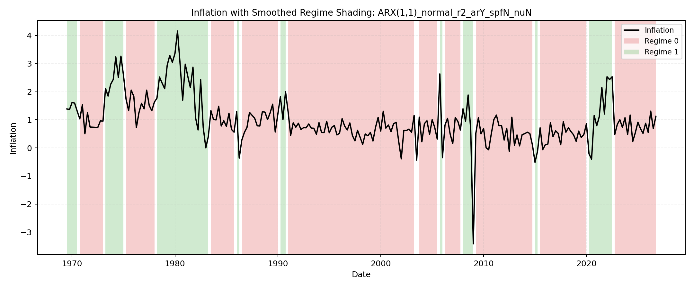

```{raw:typst}
#set page(margin: auto)
```

# Best Regime-Switching Model

The initial search used the former transition and variance cutoffs. The expanded admissible set requires a fresh 5,000-start search.

Selected by AIC among the eligible estimates. Regimes are labeled by increasing innovation variance.

Final-solution stability: not_checked.

## Model Summary
| Mean process | Regime-switching parts | Non-switching parts | LogLik | AIC | BIC |
| --- | --- | --- | --- | --- | --- |
| ARX(2,2) | AR block, including $c$, $\sigma^2$ | SPF block | -160.0023 | 360.0046 | 428.7662 |

## Switching Blocks
| Block | Switching |
| --- | --- |
| AR block, including $c$ | Y |
| SPF block | N |
| Shock distribution ($\sigma^2$) | Y |

## Mean Process
$$
\pi_{t+1} = c_{s_t} + \rho_{1,s_t}\,\pi_t + \rho_{2,s_t}\,\pi_{t-1} + \phi_1\,SPF_t + \phi_2\,SPF_{t-1} + u_{t+1}
$$

## Mean Parameter Values
| Parameter | Switching | Regime 0 | Regime 1 | Regime 2 |
| --- | --- | --- | --- | --- |
| $c$ | Y | 0.5822 | -0.1589 | 0.3260 |
| $\rho_1$ | Y | -0.4646 | 0.2378 | 0.2370 |
| $\rho_2$ | Y | -0.1513 | 0.3064 | -0.2269 |
| $\phi_1$ | N | 0.7508 | 0.7508 | 0.7508 |
| $\phi_2$ | N | 0.1045 | 0.1045 | 0.1045 |

## Distribution Parameters
| Parameter | Switching | Regime 0 | Regime 1 | Regime 2 |
| --- | --- | --- | --- | --- |
| $\sigma$ | Y | 0.1514 | 0.4259 | 1.1237 |

## Transition Probability Matrix
| From \ To | Regime 0 | Regime 1 | Regime 2 | Row Sum |
| --- | --- | --- | --- | --- |
| Regime 0 | 0.7557 | 0.2442 | 0.0001 | 1.0000 |
| Regime 1 | 0.0510 | 0.8992 | 0.0498 | 1.0000 |
| Regime 2 | 0.1927 | 0.0007 | 0.8067 | 1.0000 |

## Regime Classification Plot
